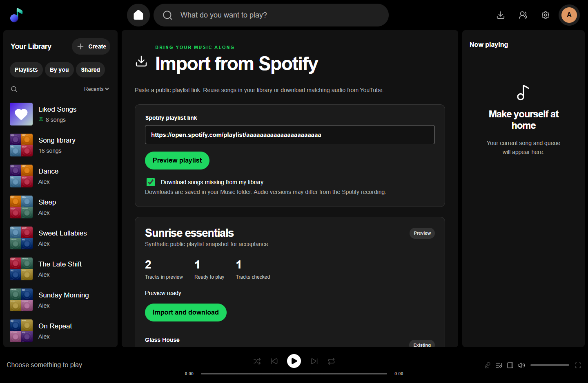

# Import a Spotify playlist

Open **Import playlist** in Music's desktop header or **Your Library** on a phone.
Paste a public `https://open.spotify.com/playlist/…` link and choose **Preview
playlist**. Spotify playlist URIs also work. No Spotify account or API key is needed.

The preview shows the tracks Spotify returned and songs already in your library.
Leave **Download songs missing from my library** checked to find matching audio
on YouTube and save tagged MP3 files in **Music/Spotify imports**. Uncheck it to
build the playlist using only songs you already have. Choose **Queue and
download** or **Queue from my library** to add it to the queue.

The playlist belongs to your Music account. Open it to play, edit or share it
with MyAccounts members using the existing view/play sharing controls. The server's
underlying Music folder keeps its existing shared-library permissions.

## Progress and recovery

You can keep listening, leave the import screen or close your browser. The server
continues working. **Recent imports** shows twenty recent jobs plus all queued
and running jobs for your account, with individual song results and queue positions.
Playlists run one at a time, in the order you queue them. Preview and queue more
playlists while another import runs; the next starts automatically.

**Stop import** stops the current download and keeps songs already added.
**Resume unfinished songs** continues the same playlist, reusing successful work.
**Remove from queue** pauses a waiting playlist. After a server restart or update,
accepted queued and running imports automatically continue from saved progress,
on the same playlists. Explicitly stopped imports stay paused until you resume
them; previews and completed/failed jobs do not start by themselves. Failed
matches and unavailable audio stay visible; they are never counted as downloaded.
Existing files are never overwritten. Each imported track is added once to the
playlist, in the order received from Spotify.

## Source details

Spotify supplies playlist metadata; audio is matched and downloaded from YouTube.
Versions can differ from Spotify's recording. Matching checks the song title,
artist and duration and avoids obvious covers, karaoke and alternate versions.
Title, artist and source link are written into each file. Album, year and cover
art are added when Spotify makes them available. Missing optional artwork does
not discard audio. No Spotify stream, DRM, browser cookies or account credentials
are used by the downloader.

Spotify may return a limited public snapshot, especially for large playlists.
Review its track count before starting; the app does not claim that this is the
complete original playlist. Private playlists must be made public to use this
flow. Unsupported episodes/local entries and tracks longer than thirty minutes
are omitted. A single import accepts up to 1,000 returned tracks.

Windows releases bundle pinned, checksum-verified yt-dlp and Node.js alongside
the existing FFmpeg. No extra program installation is needed. Provider changes,
sign-in requirements or service availability can prevent a download; these show
as per-song failures and can be retried later. Source builds need the tools
prepared by `scripts/prepare-import-tools.py` or available on PATH.

Audio matching first searches quoted song and primary-artist names, then uses
a broader fallback. Topic/VEVO channel labels, official audio/video labels and
credited featured artists do not prevent a match. Artist, title, version and
duration checks still apply. Search-response errors and unavailable matches have
distinct messages. After updating, use **Resume unfinished songs** on an existing
partial import; completed songs stay in the same playlist.

Playlist covers are copied into Music's private image storage during import.
Track covers use Spotify's current public artwork metadata and are embedded in
newly downloaded MP3s. To repair the missing playlist cover on an older import,
select it under Recent imports and choose **Refresh artwork**. This saves only
the cover, retains existing songs and playlist identity, and keeps a custom cover
if one is already present. Unavailable artwork does not discard downloaded audio.

## Engineering checks

Imports use the existing signed account identity, same-origin/CSRF protection
and private cache policy. Jobs bind to stable account principals, not reusable
numeric IDs; another user cannot list, read, start or cancel them. Only fixed
Spotify metadata hosts and canonical YouTube video IDs reach the tools. User
input never becomes a shell command or output path. Download subprocesses have
timeouts, explicit cancellation and bounded output. Publisher and Workspace
secrets are removed from their environments. Tools ignore external configuration
and plugin directories. Public provider content is parsed as data.

Tests use synthetic identities, SQLite stores and original generated audio in
fresh task directories. Public metadata resolution and a YouTube Audio Library
download are separately checked without using owner accounts or libraries.
